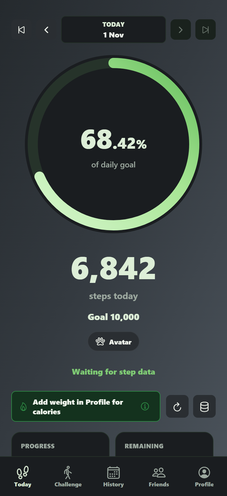
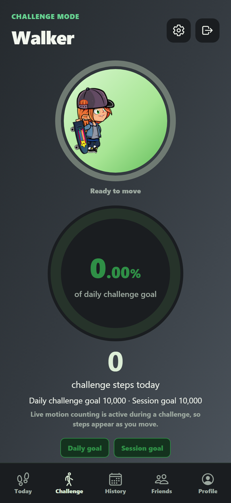
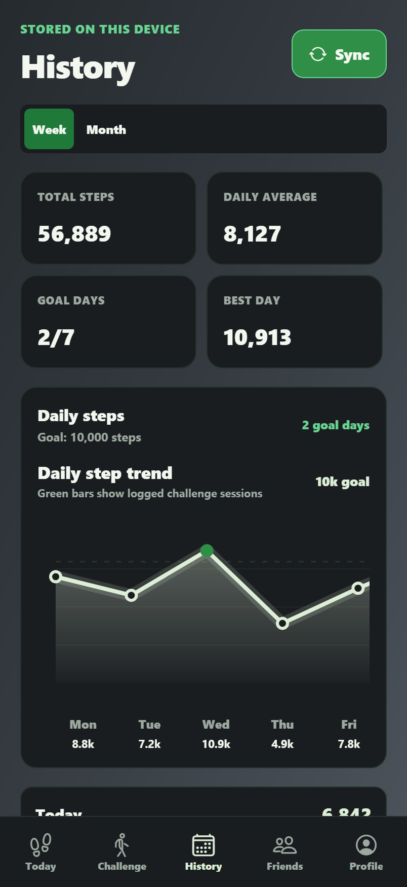

# StepCounter

A React Native walking tracker built with Expo and TypeScript. During a walking challenge, the phone’s motion sensors drive a live step counter and an animated skater. The daily dashboard brings those short sessions into context with a step goal and a browsable activity history.

|                                Today                                |                               Walking challenge                                |                              History                               |
| :-----------------------------------------------------------------: | :----------------------------------------------------------------------------: | :----------------------------------------------------------------: |
|  |  |  |

Mobile-sized captures from the web build with sample activity stored locally.

## Inside the app

- **Live motion.** The challenge counter processes accelerometer and gyroscope samples as they arrive. Cadence determines whether the skater walks or runs, and the sensor console shows why a sample was accepted or rejected. [Motion counter](src/features/challenges/presentation/useMotionChallengeCounter.ts) · [Sprite animation](src/components/avatar/DashboardAvatar.tsx)
- **Interactive history.** Swipe the dashboard ring to revisit a day, switch the history chart between a week and a month, or tap a point for that day’s total. [Dashboard](src/features/dashboard/presentation/DashboardScreen.tsx) · [History](src/features/history/presentation/HistoryScreen.tsx)
- **Device and cloud data.** The app reads steps from Apple Health or Android Health Connect on supported devices, keeps activity under user-scoped storage keys, and syncs with Firestore. [Architecture and sync policy](ARCHITECTURE.md)

## Run locally

Use Node.js 22 and install the locked dependencies.

```sh
npm ci
```

Copy `.env.example` to `.env` and fill in the six Firebase client configuration values. In your Firebase project, enable Email/Password authentication, create a Firestore database, and deploy the included access rules.

```sh
npx firebase-tools deploy --only firestore:rules --project YOUR_FIREBASE_PROJECT_ID
```

Run `npm run web` to explore the interface in a browser. Register an account on the sign-in screen. For motion tracking and health permissions, use a physical device and a native development build with `npm run android` or `npm run ios` (iOS builds require macOS and Xcode).

## Development checks

```sh
npm run check
npm run format:check
```

The first command runs the TypeScript compiler, ESLint, and Vitest. The tests cover step reconciliation, cadence, challenge metrics, profile handling, and user storage isolation.

[MIT license](LICENSE)
